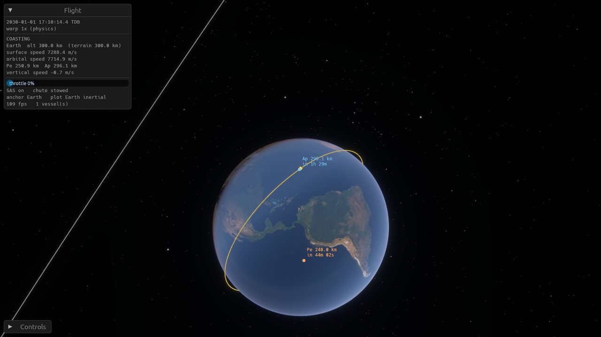
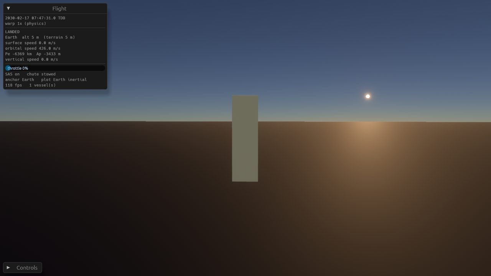

# Sunscatter

Sunscatter is a real-scale spaceflight, mission-design and logistics game. It is being rebuilt from scratch in 3D.

| Version | Status | Where |
|---|---|---|
| **v0.1** | Archived 2D prototype in Rust/wgpu. It is still runnable. | [`archive/v0.1/`](archive/v0.1), whose README has screenshots, features and build instructions |
| **v0.2** | In development. The Falcon 9 Block 5 with Crew Dragon, built from parts with their systems (plumbing, engines, structure, power, sensors, failures), flies from the pad through stage separation. The whole Solar System is on its real orbits, with measured gravity fields, terrain and atmospheres; one look, no graphics settings. Saves, map view, a tracking station, a burn planner and an MCP server for your own AI agent. See [the systems](docs/systems/README.md) for what is built and how far. | [`crates/`](crates), [`docs/`](docs) |

## Running v0.2

```bash
./run                # the game (release build; run.cmd on Windows)
cargo test -p sim    # simulation tests (deterministic; CI runs them on macOS and Windows)
```

Keys: Z full throttle, X cut; W/S, A/D, Q/E pitch, yaw and roll; I/K, J/L, H/N translate; T SAS, R RCS; Space the next stage, P parachutes; `.` and `,` warp, `/` back to 1×; Tab the systems screen, M the tracking station; Cmd+S / Cmd+L quicksave and quickload (Ctrl+Alt off a Mac); `[` and `]` the previous and next vessel; Shift+/ help; Esc the menu (settings, the performance overlay). The full list is in Settings ▸ Controls. Developer commands are in [CLAUDE.md](CLAUDE.md).




## Reading guide

### For a person, in order

1. [Vision](docs/vision.md): what the game is, its pillars and non-goals.
2. [The systems](docs/systems/README.md): one short doc per system (motion, the world, the ship, propulsion, structure, aero and thermal, avionics, crew, failures, the game), each saying what is built, with honest status words, and what is not.
3. [The decision log](docs/decisions.md): what has been decided, and why. The systems docs cite it by number.
4. [The hand-off](docs/plans/HANDOFF.md): what is being worked on now and what is next.
5. For depth: [technical/](docs/technical/) (one topic per file, starting with the [motion model](docs/technical/motion-model.md) and the [ship model](docs/technical/ship-model.md)) and [vehicles/](docs/vehicles/) (the [Falcon 9 dossier](docs/vehicles/falcon9.md), every number sourced).
6. History: [archive/](docs/archive/) holds the owner's interviews, finished plans and briefs, research notes and reviews, and [lessons from v0.1](docs/archive/research/lessons-from-v0.1.md).

### For an agent, in order

1. [CLAUDE.md](CLAUDE.md) (loaded automatically): the rules and the commands.
2. [The hand-off](docs/plans/HANDOFF.md) (loaded by the SessionStart hook): the state, the next steps and the gotchas. An agent of the lead's reads [agent-rules.md](docs/plans/agent-rules.md) and its brief next.
3. [The vision](docs/vision.md), then the [decisions](docs/decisions.md) the work touches (check before proposing).
4. [owners.md](docs/owners.md): search it before writing a function; extend the owner instead.
5. The [systems doc](docs/systems/README.md) of the system being worked on, then its technical docs, read by section.
6. [process.md](docs/process.md): the documents, the research strategy, the engineering rules.

The archive is read only where a doc points into it.

### The layout

```
README.md            this guide
CLAUDE.md            rules and commands for agents
docs/vision.md       the game
docs/decisions.md    what is decided
docs/owners.md       who owns what, by system
docs/process.md      how the work is done
docs/systems/        one general doc per system, open to new ones
docs/technical/      specific details, one topic per file
docs/vehicles/       research dossiers of real vehicles
docs/plans/          live work and HANDOFF.md
docs/archive/        finished plans, briefs, interviews, research
```
